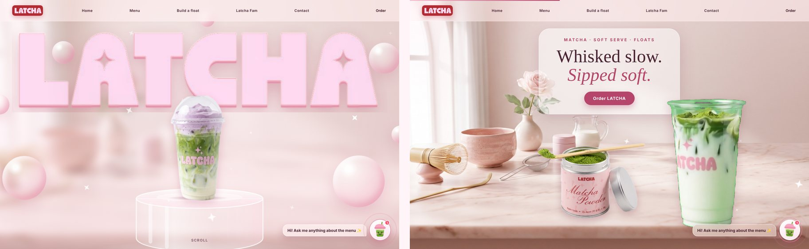

<div align="center">


# LATCHA

### Speciality matcha, cloud lattes and premium soft serve.<br>One scroll to browse. One form to order. One link for everything.

<br>


<br>



</div>

<br>

<!-- Add the live link here once the site is deployed:
<p align="center"><a href="https://YOUR-SITE.vercel.app"><b>View the live site →</b></a></p>
-->

## ✨ What it is

The LATCHA website and its backend in **one project**. One deploy gives one link: the site is at `/`, the API is at `/api`, the owner screen is at `/admin.html`.

| For customers | For the owner |
|---|---|
| A scroll story, the full menu, a float builder and the Latchi chat helper | Edit what is on the menu |
| **+ Add** on every dish, a cart bar, and an **Order request** form (name, phone, address) | See every order and set its status |
| **Reviews**: read approved ones, write your own | Approve or delete reviews before the public sees them |

**The site never breaks if the backend is down.** It starts with the built-in menu, then swaps in the database menu when the API answers.

<br>

## 🧱 How the pieces fit

```
Browser ──▶  /              the website            (site/index.html)
        ──▶  /api/...       FastAPI + SQLAlchemy   (app/)
        ──▶  /admin.html    owner screen           (site/admin.html)
                                  │
                                  ▼
                           Neon PostgreSQL  (menu_items, orders, order_lines, reviews)
```

<br>

## 🖱 What every button does

| Where | Control | What happens |
|---|---|---|
| Top bar | **Home, Menu, Build a float, Latcha Fam, Reviews, Contact** | Scrolls to that section (phone: through the menu button) |
| Top bar | **Order** | Opens the order form. Shows **Order (3)** when you have 3 items |
| Top bar (phone) | **Menu button** | Opens the links. `Esc` or tapping a link closes it |
| Hero | **Order LATCHA** | Opens the order form |
| Hero video | **Tap to play** | Starts the pouring video when the phone blocks autoplay |
| Instagram card | **Follow @siplatcha** | Opens Instagram in a new tab |
| Instagram card | **See the menu**, highlight circles | Scroll to the menu or the matching section |
| Instagram card | **Photo tiles** | Open @siplatcha on Instagram in a new tab |
| Menu | **+ Add** on each of the 33 dishes | Adds the dish to your order and shows a short message. Tap again for more. The button shows **Added ✓ ×2** |
| Bottom of screen | **Review your order** | Appears once you add something. Opens the order form |
| Order form | **− / +** | Change how many of each dish |
| Order form | **Send order request** | Saves the order. LATCHA calls to confirm. No payment is taken |
| Float builder | Latte, soft serve, extra matcha | Changes the picture and the summary |
| Float builder | **Add this float to my order** | Adds the matching float from the menu and puts your latte and extra matcha in the order notes |
| Float builder | **Ask Latchi about it** | Sends your float to the chat helper |
| Reviews | **Send review** | Goes to the owner. It appears on the site once approved |
| Footer | **Follow @siplatcha** | Opens Instagram in a new tab |
| Footer | **Delivery & hours** | Opens Latchi with the delivery answer and an **Open order form** button |
| Chat bubble | **Latchi** | Answers menu questions. Say "order now" or press **Open order form** to order |

If the backend is offline, the **+ Add** buttons are hidden and **Order** opens Latchi instead, so nothing shows an error.

<br>

## 🔌 The API

| Endpoint | Who | What |
|---|---|---|
| `GET /api/menu` | public | Menu items that are switched on |
| `POST /api/orders` | public | Order request. No prices or payment: LATCHA confirms by phone |
| `GET /api/reviews` | public | Approved reviews only |
| `POST /api/reviews` | public | Goes to the owner's queue, hidden until approved |
| `POST /api/admin/login` | owner | Gives a token that lasts 2 hours |
| `/api/admin/menu`, `/orders`, `/reviews` | owner | Switch dishes on or off, change order status, approve or delete reviews |
| `GET /api/health` | anyone | Checks the database answers |

Try everything in the browser at **`/docs`**.

**Safety built in**
- Passwords are stored as salted hashes, never as plain text.
- Orders are checked (Indian mobile number, 1 to 20 of each drink, Bengaluru or Hyderabad only), and the drink name is saved at order time. Maximum 5 orders per phone per hour.
- Reviews stay hidden until approved. A hidden field catches simple spam bots. The waiting queue is capped.
- Review and order text is always shown as plain text, so nobody can inject code into the site or the owner screen.
- Database rules (rating 1 to 5, sweetness 0 to 5, quantity 1 to 20) are enforced in the database too.

<br>

## 🚀 Try it on your computer

You need **Python 3.11 or newer**. Open a terminal **inside this folder**:

```powershell
python -m venv .venv
.venv\Scripts\activate
pip install -r requirements-dev.txt
python scripts/init_db.py
python -m uvicorn app.main:app --port 8000 --reload
```

Open **http://localhost:8000**. This uses a small local file database (`dev.db`), so you do not need Neon yet.

To try the owner screen locally, copy `.env.example` to `.env`, then fill in `ADMIN_PASSWORD_HASH` and `JWT_SECRET` (steps in the next section) and restart.

Run the tests any time: `python -m pytest -q`

<br>

## 🗄 Connect Neon (the real database)

1. On [neon.com](https://neon.com) create a project. Copy the **pooled** connection string (the host contains `-pooler`).
2. Make your owner password hash and a secret:
   ```powershell
   python scripts/make_admin_hash.py
   python -c "import secrets;print(secrets.token_urlsafe(48))"
   ```
3. Put the three values in `.env` (this file is never uploaded to GitHub):
   ```
   DATABASE_URL=postgresql://...-pooler.../neondb?sslmode=require
   ADMIN_PASSWORD_HASH=pbkdf2$...
   JWT_SECRET=the-long-random-text
   ```
4. Create the tables and load the menu in Neon: `python scripts/init_db.py` (safe to run twice).

<br>

## 🌐 Put it online with Vercel (one project, one link)

1. **Push to GitHub.** In your project folder, delete the old files (keep the hidden `.git` folder), copy these new files in, then:
   ```powershell
   git add -A
   git commit -m "Add backend, order form and reviews"
   git push
   ```
2. **Vercel:** delete the old project (Settings, General, Delete Project), then **Add New, Project** and import the repo again.
3. Leave **Framework Preset** on **FastAPI** (or auto-detected). Leave Build and Output settings empty.
4. Before the first deploy open **Environment Variables** and add: `DATABASE_URL`, `ADMIN_USERNAME`, `ADMIN_PASSWORD_HASH`, `JWT_SECRET`. (`CORS_ORIGINS` is only needed if another website calls the API.)
5. Deploy. Then check, in this order:
   - `/api/health` shows `{"ok": true}`
   - `/` shows the site and the menu loads
   - `/admin.html` lets you log in

Neon's free plan puts the database to sleep after 5 minutes idle, so the first request after a quiet spell is slower. The menu is cached for a minute so most visitors never feel it.

<br>

## 🗂 What is in the folder

```
site/                   the website, served at /
├── index.html          the whole site (HTML, CSS, JavaScript)
├── admin.html          owner screen: orders, reviews, menu on/off
└── assets/             pictures and videos
app/                    the backend
├── main.py             starts the app, serves the site, security headers
├── routes.py           all API endpoints
├── models.py           database tables
├── schemas.py          what each request must look like
├── security.py         password hashing and login tokens
├── db.py, config.py    database connection and settings
scripts/
├── init_db.py          create tables, load the 33 menu items
└── make_admin_hash.py  make the owner password hash
tests/                  19 automated tests
index.py                the file Vercel looks for (loads app/main.py)
requirements.txt        Python packages
.env.example            the settings you need (copy to .env)
docs/, tools/           README pictures, and a macOS cut-out helper
```

<br>

## ✅ How it was tested

| Check | Result |
|---|---|
| 19 automated API tests (orders, reviews, login, limits, cache, site serving) | Pass on SQLite and on PostgreSQL 16 |
| Browser run with Chromium: menu from the database, hidden dish removed, order, bad phone message, review, owner approval, scripts in reviews do not run | Pass |
| Site with the backend switched off (built-in menu, calm messages, Order opens Latchi) | Pass |
| Sideways scrolling on a 390 px phone | None |
| Live Vercel deploy and the Neon connection | **Pass.** `/api/health` returns `{"ok":true}` on the live site, and `/admin.html` loads |
| Safari, iPhone and Android | **Pass.** Tried on real devices by the site owner |

<br>

## 📝 Before launch

- [ ] **Zomato and Swiggy links.** The footer button **Delivery & hours** opens Latchi's answer. Add real Zomato and Swiggy links if you want people to jump there.
- [ ] **Who gets the orders.** Orders only appear in `/admin.html`. There is no email, SMS or WhatsApp alert yet, so someone must check it.
- [ ] **Story reviews.** The three review cards in the scroll story are sample text until three real reviews are approved.
- [ ] **Instagram numbers.** The post and follower counts are typed into the page.
- [ ] **Opening hours.** Latchi says "Bengaluru till 1 AM, Hyderabad till 12 AM". Confirm this.
- [ ] **Menu spelling.** "Caramel Toffe" is probably "Caramel Toffee".
- [ ] **Photos.** Most pictures are AI-generated stand-ins. Replace them with LATCHA's own.
- [ ] **Page weight.** The first load is about 12 MB. WebP versions of the pictures would help on mobile data.
- [ ] **New dishes need a picture.** Add `site/assets/menu/<category>-<number>.png`, where the number matches the dish's `position`. Without one, the card shows without a picture.

<br>

## ⚖️ Content and rights

- The **LATCHA** name, logo, menu and copy belong to LATCHA. Please do not reuse them without the owner's permission.
- Most other pictures are AI-generated stand-ins. No open-source licence is attached to this code, so please ask before you reuse it.
- Fonts: Bagel Fat One, Gloock, Nunito Sans and Pinyon Script, from Google Fonts.

<br>

<div align="center">


<sub>Whisked slow. Sipped soft. 🍵</sub>

</div>
