<div align="center">


# LATCHA

### A matcha café website that moves, swirls and actually takes orders.
One scroll to fall in love. One form to order. One link for everything.

*Whisked slow. Sipped soft.* 🍵

<br>


<br>

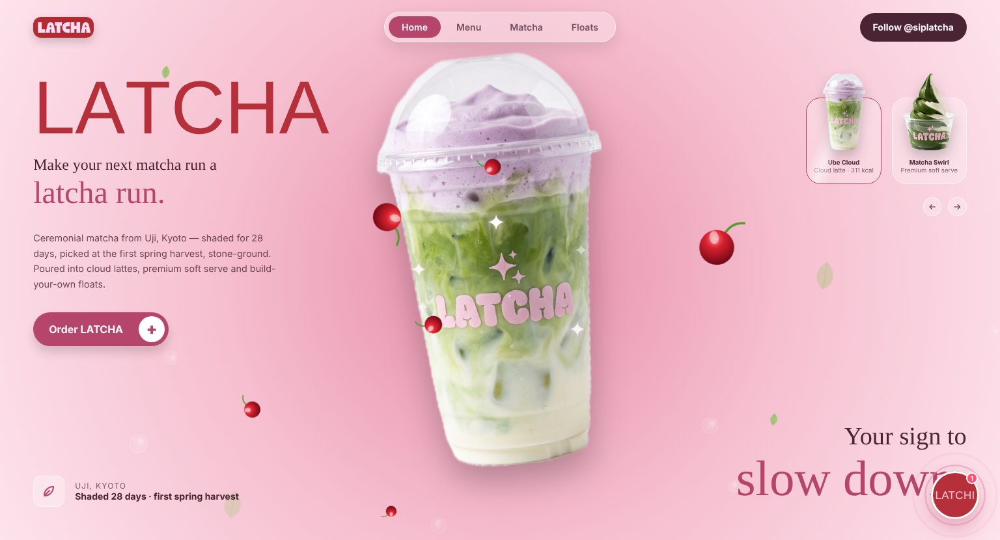

<br>

**[🍵 Live site](https://latcha-website.vercel.app)** &nbsp;·&nbsp;
**[🚀 Run it](#-run-it-in-60-seconds)** &nbsp;·&nbsp;
**[✨ Features](#-what-you-get)** &nbsp;·&nbsp;
**[🍵 Latcha Club](#-latcha-club-accounts-and-points)** &nbsp;·&nbsp;
**[🔌 API](#-the-api)** &nbsp;·&nbsp;
**[🌐 Deploy](#-put-it-online-with-vercel)**

<sub>Built for the LATCHA matcha café · Bengaluru &amp; Hyderabad</sub>

</div>

<br>

## 🌸 What you get

| | |
|---|---|
| 🥤 **A cup you can play with** | The hero cup floats and tilts with your mouse or phone. Cherries and leaves drift around it. One flavour tap turns the whole background from rose to matcha green. |
| 🎬 **A scroll that tells a story** | Cups, the matcha tin on marble, then the pour. Smooth scroll, no jumps. |
| 🛒 **A real shop behind the page** | 33 dishes, a cart, live order tracking with a share link, reviews and an owner screen, all backed by a database. |
| 📍 **Outlets** | Pick JP Nagar or Sattva Knowledge Park. See "Open now" before ordering. |
| 💳 **UPI payments** | Pay by UPI or at delivery. Demo mode today; Razorpay when you add keys. |
| 🍵 **Latcha Club** | Customers make an account, collect points every day they visit, and turn **500 points into ₹50 off** at checkout. The owner can change every number. |
| 📲 **Instant order alerts** | Every new order pings the owner's Telegram within a second, with a button that opens the owner desk. |
| 📱 **Install as an app** | Add LATCHA to the phone home screen. It opens full-screen with its own icon. |
| 💗 **Latcha Fam** | 8 sips = 1 free drink, counted from the customer's phone number. |
| 🔎 **Find my matcha** | A 4-tap quiz that picks a drink from the live menu. |
| 📊 **Owner desk** | A pink, phone-friendly screen for orders, dashboard, reviews, menu, outlets and loyalty. |
| 🛡 **Safe by default** | Hashed passwords, spam trap, order limits, private tracking, signed payments, reviews held until approved. |
| ✅ **Tested** | 147 automatic tests (API and real-browser) run on every push. |

<br>

## 🍃 A day with LATCHA

| Time | Customer | Owner |
|---|---|---|
| ☀️ Morning | Opens the site, collects the day's **Club points**, takes the **Find my matcha** quiz and adds the match to the cart | Opens `/admin.html` and sees overnight orders |
| 🌤 Afternoon | Picks an outlet, taps **Use my points** for ₹50 off, pays by UPI and gets an order number | Gets the order in **Orders**, calls to confirm, taps **Confirm order** |
| 🌙 Evening | Tracks the order until it says **Delivered**. A sip lands on the Fam card | Taps **Mark delivered**, marks a sold-out dish, checks the **Dashboard** |

<br>

## 📸 A quick look

<p align="center">

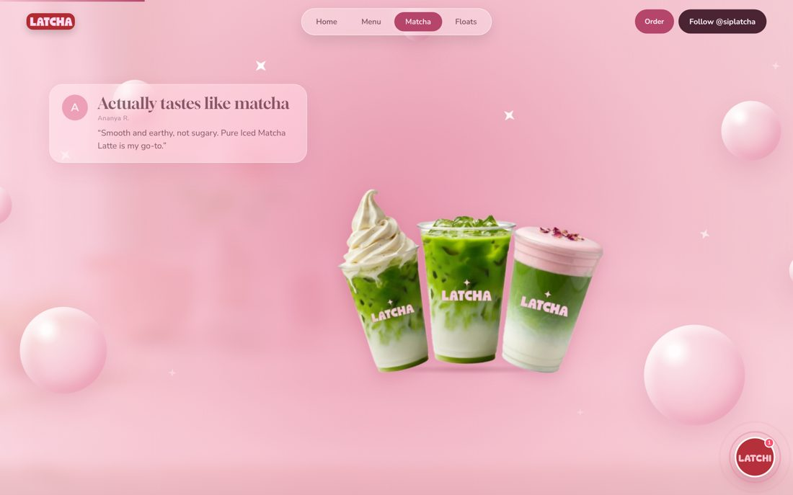
</p>
<p align="center">

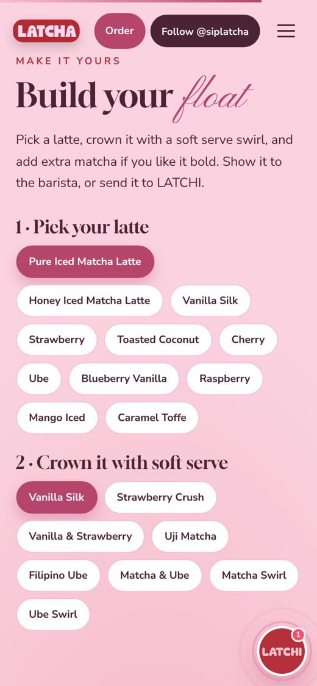
</p>
<p align="center">

</p>
<p align="center">
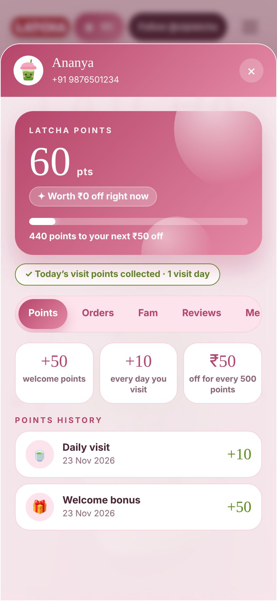
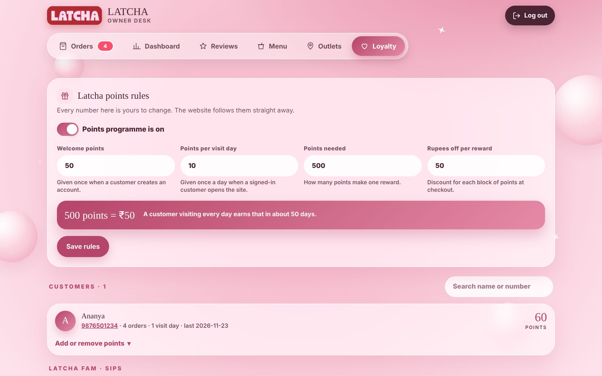
</p>
<p align="center"><sub>Left: a customer's Latcha Club window on a phone. Right: the owner changing the points rules.</sub></p>
<p align="center"><sub>Preview pictures show the page before the 3D cherries load. On the live site they are real 3D cherries.</sub></p>

<br>

## ⚡ Run it in 60 seconds

```powershell
python -m venv .venv
.venv\Scripts\activate
pip install -r requirements-dev.txt
python scripts/init_db.py
python -m uvicorn app.main:app --port 8000 --reload
```

Open **http://localhost:8000**. No database account needed: it uses a small local file (`dev.db`). To try the owner screen, copy `.env.example` to `.env` and fill in `ADMIN_PASSWORD_HASH` and `JWT_SECRET` (see [Connect Neon](#-connect-neon-the-real-database)).

Run the tests any time: `python -m pytest -q` (browser tests need `playwright install chromium` once). They use a throw-away database, never your live site.

<br>

## ✨ Features in detail

### 🍵 Latcha Club: accounts and points

Customers can make a free account, collect **Latcha points** and spend them at checkout. It sits next to Latcha Fam: Fam rewards drinks, Club rewards visits.

<p align="center"></p>

**How customers use it**

- **Sign up or sign in** from the top-bar button, the menu, or the strip inside the order window. Mobile number + password; no email needed.
- **Earn:** a welcome gift when the account is made, then points **once per calendar day** (Indian time) the customer opens the site while signed in.
- **Spend:** in the order window tap **Use my points**. Every full block of 500 points takes ₹50 off the bill, never more than the bill itself.
- **See everything:** the Club window has tabs for **Points** (balance, progress to the next reward, full history), **Orders** (with status), **Fam** (sips), **Reviews** and **Me** (change name or password).
- **Birthday:** save your birthday once in the **Me** tab. On the day, opening the site adds birthday points (once a year; not on the day the account was made).
- **We miss you:** come back after a break (14 days by default) and the first visit adds comeback points.
- A cancelled order gives the points back, once.

**How the owner controls it** (Admin → **Loyalty**)

| Setting | Default | Meaning |
|---|---|---|
| Points programme on/off | on | Pause it any time. Balances are kept |
| Welcome points | 50 | Given once at sign-up |
| Points per visit day | 10 | Given once a day to a signed-in customer |
| Points needed | 500 | Size of one reward block |
| Rupees off per reward | 50 | Discount for each block |
| Birthday points | 50 | Once a year, on the birthday. 0 turns it off |
| Comeback after (days) | 14 | How long away counts as a break |
| Comeback points | 25 | Bonus on the first visit back. 0 turns it off |

Saving takes effect on the site straight away. The same tab lists every customer (search by name or number) and lets the owner **add or remove points** with a note, which is also written to the customer's history.

**How it is built:** tables `customers` (balance, visits, last visit day), `point_tx` (every change: welcome, visit, redeem, refund, adjust) and `settings` (the rules above). The balance only changes through one function (`add_tx` in `app/loyalty.py`), so the history always adds up. Login uses a 30-day token that is separate from the owner's.

- **Phone code (optional):** set `OTP_MODE=demo` and sign-up asks for a 6-digit code (valid 10 minutes, 3 requests an hour, 5 tries). In demo mode the code is shown on screen and **no SMS is sent**. Real SMS needs a provider (for example MSG91 or Twilio) and a small code change. With `OTP_MODE=off` (default) there is no check.
- ⚠️ **Limit:** with the code off, a mobile number is not proven to belong to the person signing up, and Latcha Fam cards still use only the phone number. Set a long `JWT_SECRET`, accounts need it.
- Customers only see orders placed **while signed in**. Guest orders still work exactly as before.

### 📲 Instant order alerts (Telegram)

The owner does not have to keep `/admin.html` open. When an order comes in, a Telegram message arrives with the outlet, customer, address, items, total, how it is paid, and a button that opens the owner desk. UPI orders ping once the payment is confirmed; pay-at-delivery orders ping straight away.

1. In Telegram, message **@BotFather**, send `/newbot`, copy the token.
2. Send any message to your new bot, then open `https://api.telegram.org/bot<TOKEN>/getUpdates` and copy the `chat` → `id` number.
3. Add `TELEGRAM_BOT_TOKEN` and `TELEGRAM_CHAT_ID` in `.env` and in Vercel → Settings → Environment Variables, then redeploy.
4. In the owner desk press **📲 Alerts on · send test**.

If the two values are empty it simply does nothing. A Telegram failure never stops an order (the call gives up after 4 seconds and the error is logged). Customer text is escaped, so nobody can inject formatting.

### 📱 Install LATCHA on a phone

`manifest.webmanifest`, `sw.js` and the icons in `site/icons/` make the site installable. On Android and desktop Chrome or Edge the burger menu shows **📲 Install the LATCHA app**. On iPhone, the button explains: Share → **Add to Home Screen**. The owner desk has its own manifest, so it can be installed too. The service worker never touches `/api`, so orders and points are always live; offline it shows the last saved home page.

### 📍 Outlets

LATCHA has more than one shop, so the site does too. Customers pick an outlet in the order window and see if it is open right now. The owner can pause an outlet, change its hours, or mark a dish **sold out at one outlet only**, all in `/admin.html` → **Outlets**.

<p align="center">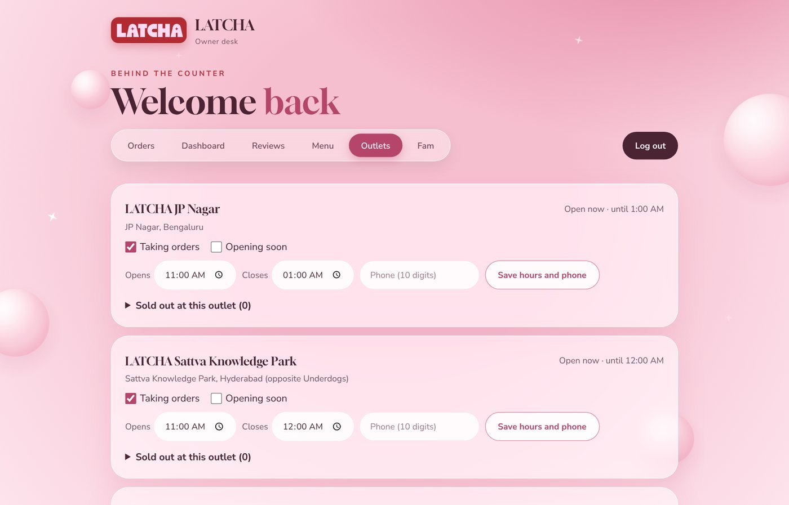</p>

- `GET /api/outlets` lists outlets with a ready "Open now · until 1:00 AM" sentence.
- Closed, paused, "opening soon" and sold-out cases get a clear message when ordering.
- Seeded outlets: **LATCHA JP Nagar** (Bengaluru, 11:00 to 01:00), **LATCHA Sattva Knowledge Park** (Hyderabad, 11:00 to 00:00), **LATCHA Indiranagar** (opening soon). Confirm the real hours and addresses before launch.
- Old orders and the old city-only form keep working. Existing databases upgrade themselves on start (`app/outlets.py`).

### 💳 UPI payments

Customers can pay by UPI in the order window, or choose pay at delivery. **The total is always worked out on the server from the menu prices**, never from the browser.

<p align="center">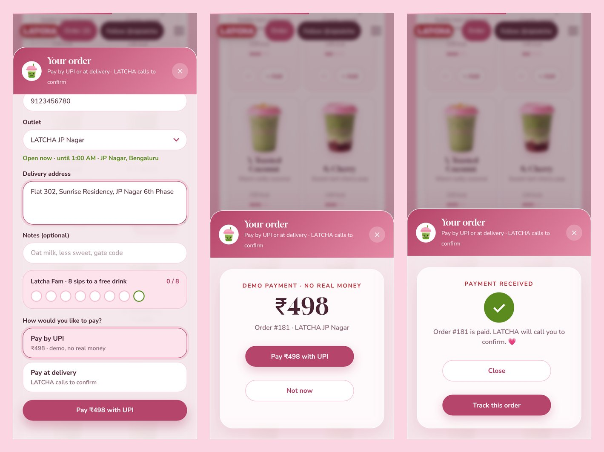</p>

| `PAYMENTS_MODE` | What happens |
|---|---|
| `demo` (default) | A pretend pay screen. No money moves. Good for showing the owner. |
| `razorpay` | Real Razorpay Checkout, UPI only. Test keys (`rzp_test_...`) use fake money. |
| `off` | No UPI choice. The site works like a plain order form. |

If `razorpay` is set but the keys are missing, the mode becomes `off` (it never falls back to the pretend screen).

**Razorpay test setup:** make a free Razorpay account and stay in Test Mode. Put `PAYMENTS_MODE=razorpay`, `RAZORPAY_KEY_ID`, `RAZORPAY_KEY_SECRET` and `RAZORPAY_WEBHOOK_SECRET` in `.env` and in Vercel → Settings → Environment Variables. In the Razorpay dashboard add a webhook to `https://YOUR-SITE/api/payments/razorpay/webhook` with the same secret and the events `payment.captured`, `order.paid` and `payment.failed`.

**Prices:** the first upgrade fills placeholder prices (249 / 279 / 199 / 299 rupees). Set the real ones in Admin → Menu. A UPI order is only offered when every dish in it has a price.

**Safe by design:** the server checks Razorpay's signature, a repeated payment message changes nothing, a webhook with the wrong amount is ignored, and the pretend pay button stops working as soon as real payments are on.

### 💗 Latcha Fam loyalty

Every drink that LATCHA marks **Delivered** is 1 sip on the customer's mobile number. **8 sips = 1 free drink** (change it with `FAM_SIPS_PER_REWARD`).

<p align="center">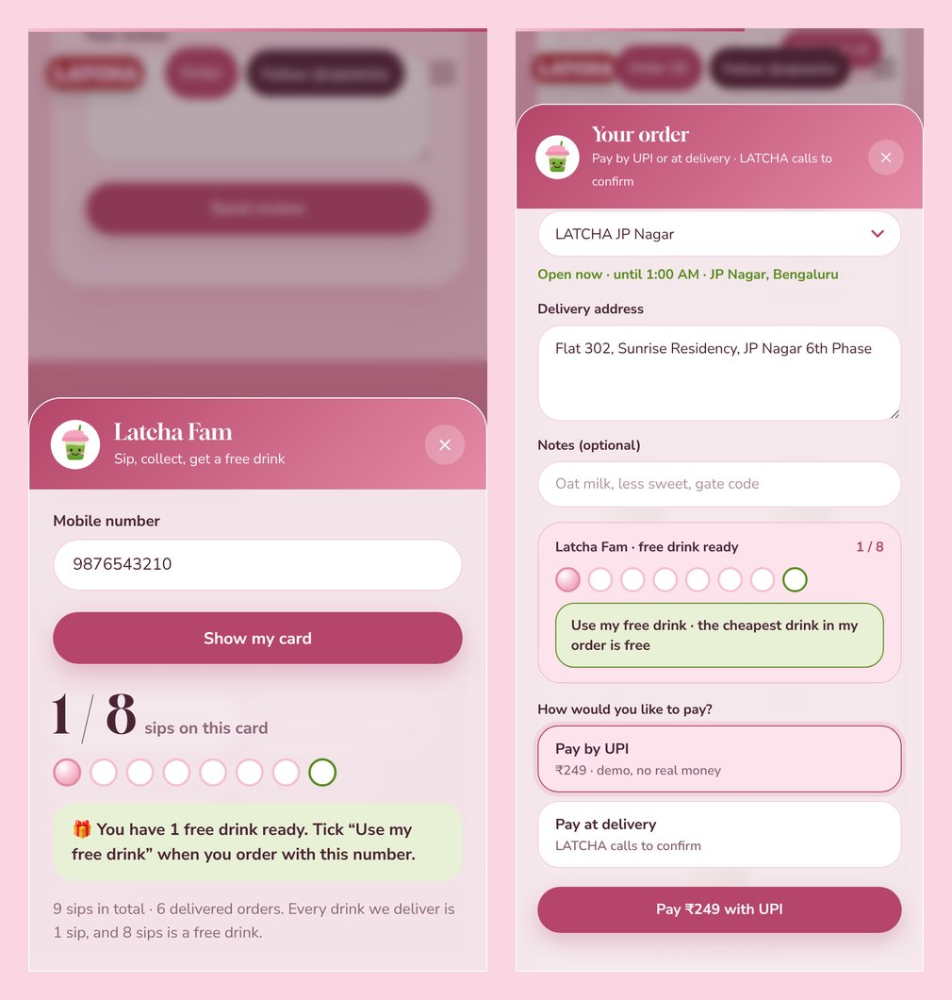</p>

- Customers see their card from the footer button **Latcha Fam**, and a small pearl strip in the order window once the mobile number is typed.
- **Use my free drink** takes off the cheapest drink in the cart. If that makes the total ₹0, no payment is asked and the order is marked paid.
- A cancelled order gives the free drink back. Nothing extra is stored: sips are counted from the orders table.
- Owner: Admin → **Fam** lists every member (sips, orders, free drinks ready or used).
- ⚠️ **Limit:** there is no OTP, so anyone who knows a mobile number can see its sips or reserve its free drink. The owner's confirmation call is the safeguard. Add a one-time code before a big launch.

### 🔎 Find my matcha quiz

A 4-tap quiz (format, flavour, sweetness, light or treat) that picks one dish and two more ideas from the live menu.

<p align="center">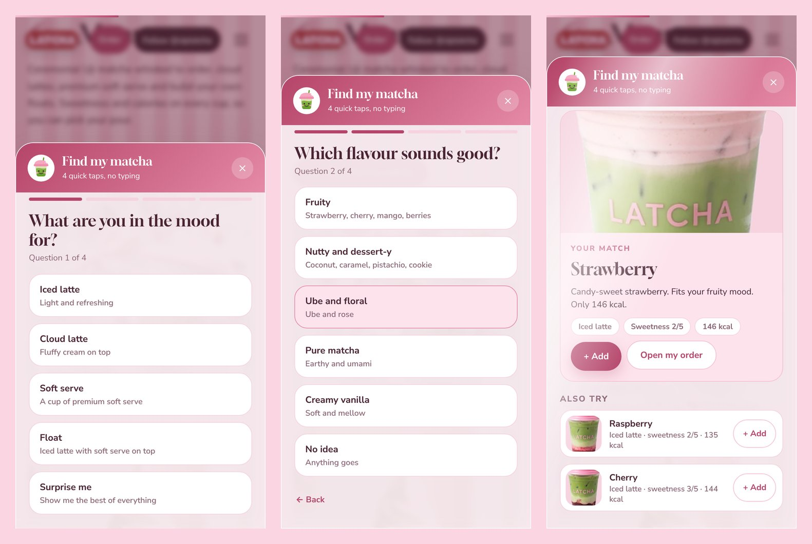</p>

- It is plain rules, not AI. A dish scores points for the chosen format, the flavour mood (found from the dish name and description), how close its sweetness is, and its calories. Best sellers get a small tie-break bonus.
- It reads the live menu, so new or edited dishes are used automatically. For a new dish to match a flavour, put words like strawberry, caramel, ube, vanilla or matcha in its name or description.
- Dishes sold out at the customer's chosen outlet are skipped.
- **Add** puts the dish in the cart; **Open my order** goes straight to the order window. Nothing is stored and there is no new table or API.

### 🧑‍🍳 Owner screen: live orders and menu editor

`/admin.html` is a pink, glassy desk that matches the shop. It greets the owner with a "Welcome back" line that fades away, and on a phone the tabs become a **bottom app bar** so a thumb reaches everything. It updates by itself every 12 seconds. A new order shows a banner, the card flashes, and the tab title shows `(2) LATCHA Owner`. Press **Sound off** once to turn on a soft beep. Tabs: Orders, Dashboard, Reviews, Menu, Outlets, **Loyalty** (Club rules, customers and Fam sips).

<p align="center">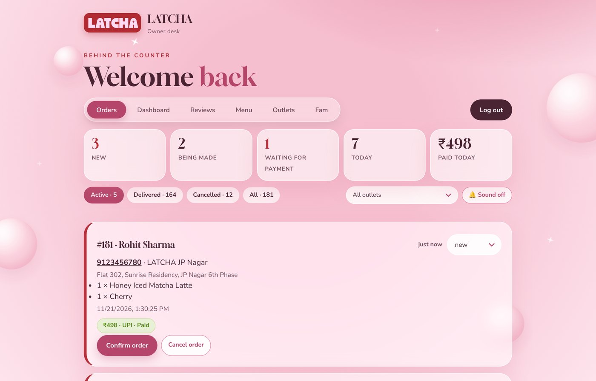</p>

- Tiles: new, being made, waiting for payment, today's orders, rupees paid today (Indian time, cancelled orders not counted).
- Filters: Active, Delivered, Cancelled, All, plus an outlet filter.
- One-tap buttons: **Confirm order**, **Mark delivered**, **Cancel order** (asks first). The phone number is tap-to-call.
- **Menu tab:** search, and **Edit details** on each dish (name, description, calories, sweetness, price, on-the-menu and best-seller switches). Order history keeps the old dish name. The home page menu boards use fixed pictures, so this edits existing dishes; it does not add or delete them.

<p align="center">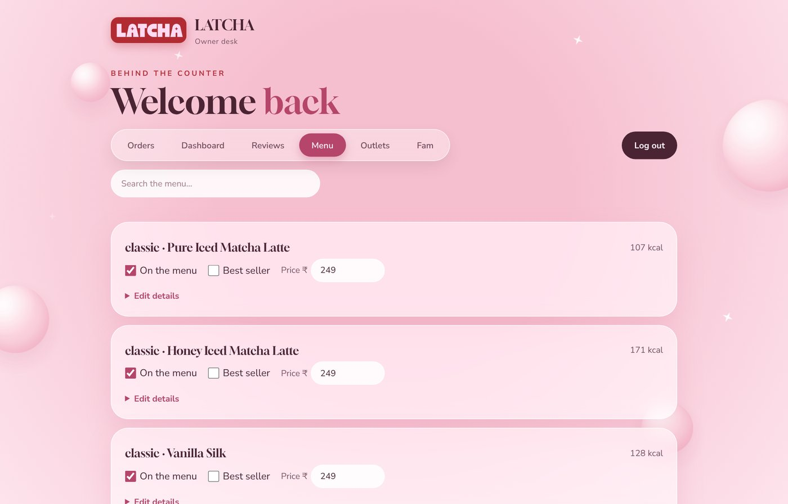</p>

### 🔑 The owner login: "open the shop"

`/admin.html` opens on a small LATCHA shopfront with a **CLOSED** sign that swings in the breeze and steam rising from a matcha cup. The greeting follows Indian time ("Good morning, owner"), and a short tip changes each visit. Sign in and the sign flips to **OPEN**, the door lights up and the desk loads. A wrong password shakes the card, and a Caps Lock warning shows while typing the password. No order data is loaded before login.

### 🛵 Live order tracking

After ordering, **Track this order** shows four steps: **Received → Making → On the way → Delivered**. The page re-checks every 10 seconds by itself, so the customer watches the status change without pressing anything. It also shows "Updated 3 min ago", a **Call the outlet** button, and **Share tracking link**.

- The owner moves an order along with one button each time: **Confirm order**, **Send out for delivery**, **Mark delivered** (or **Cancel order**). The dropdown on each card still works too.
- The share link looks like `/?track=12.a1b2c3d4e5`. The part after the dot is a secret made from the server's `JWT_SECRET`, so nobody can guess another order's link. It opens the tracker without asking for the phone number, and it never shows the name, phone or address. Paying later from the tracker still asks for the phone number.
- Ordering by phone number still works the old way (**Track your order** in the footer, or from the Club **Me** tab).

### 📊 Owner dashboard

Admin → **Dashboard** shows the last 1, 7, 30 or 90 days. Everything is counted from real orders; nothing extra is stored.

<p align="center">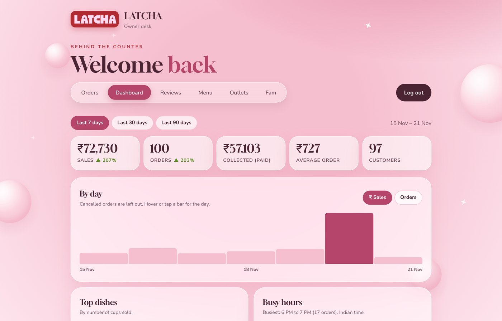</p>

- Top row: sales, orders (each compared with the period before), money collected, average order, **average time to deliver** (placed to delivered), **repeat customers** (% who had ordered before).
- Charts: sales or orders by day, top dishes, busiest hours, **best weekday**, outlets, how people pay, new and returning customers, Fam free drinks given.
- **Export orders (CSV)** downloads the orders of the chosen period. Excel and Google Sheets open it. Times are Indian time, and names that start with `=` are made safe so a spreadsheet cannot run them as a formula.
- **Sales** is the value of orders placed. **Collected** is only what is marked Paid. Cancelled orders are never counted.
- An order with no price adds to the order count but not to rupees. The page tells you how many.
- Days and hours are Indian time. A customer is one mobile number.
- Sales are only as true as your prices. Set the real prices first.
- It reads at most the last 90 days of orders, which is fine for a few thousand orders. If LATCHA grows far beyond that, move the sums into the database.
- The screenshot uses sample data, not real sales.

<br>

## 🎨 Design and speed

- **Home screen:** a thick crimson LATCHA wordmark, a tilted Ube Cloud cup with sparkles, floating 3D cherries and leaves, two flavour cards and the line "Your sign to slow down." Sizes scale with the screen width.
- **Colours:** one rose palette: rose `#f6bfd0`, deep rose `#e58aa6`, berry `#b5456a`, crimson `#b5303a`.
- **Order window:** three tabs, **Drinks**, **Cart** and **Details**, so a phone never has to scroll one long form.
- **Menu:** the burger button opens a rounded card with every section, the Club button and Order.
- **Phone inputs:** all inputs are 16px so iPhone Safari does not zoom in and push the page sideways.
- **Chat helper:** called **LATCHI** everywhere. It answers menu questions and opens the order form.
- **Smooth scroll:** Lenis (`site/assets/vendor/lenis.min.js`).
- **3D cherries and leaves:** Google's `model-viewer`. The 3D files load from the internet; flat pictures show until they arrive.
- **Speed:** 3D objects start one at a time, lower pictures load as you scroll near them, the scroll story only redraws while visible. `speed-changes.patch` holds only these edits so you can undo them with `git apply -R speed-changes.patch`.
- **Pictures:** phone photos are stored upright. Rotate a phone photo properly before saving it as WebP, or it can show sideways.
- **The site never breaks if the backend is down.** It starts with the built-in menu, then swaps in the database menu when the API answers.

<br>

## 🧱 How the pieces fit

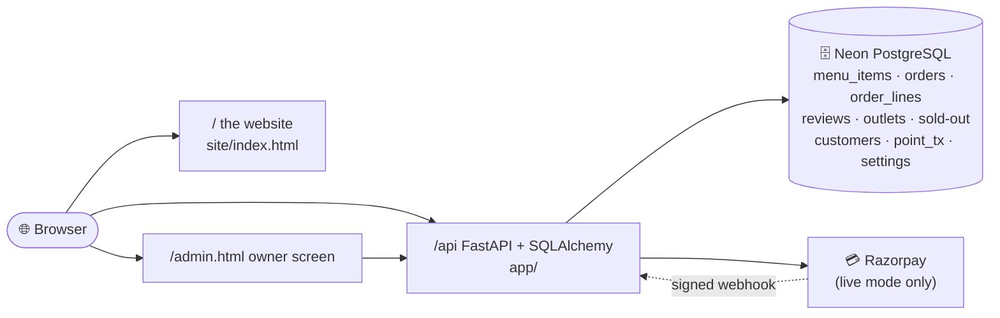

<br>

## 🔌 The API

Try everything in the browser at **`/docs`**.

**Public**

| Endpoint | What |
|---|---|
| `GET /api/menu` | Menu items that are switched on (with prices) |
| `GET /api/outlets` | Outlets with "Open now" text |
| `POST /api/orders` | Place an order (outlet, items, optional free drink). The server works out the price |
| `POST /api/orders/track` | Needs the order number **and** the phone used. Returns status, items, outlet and a private tracking `code` |
| `GET /api/orders/track/{code}` | The share link. The secret code replaces the phone number. Same 404 for every wrong code |
| `GET /api/payments/config` | Which payment mode is on |
| `POST /api/orders/{id}/pay` | Start a UPI payment |
| `POST /api/orders/{id}/pay/confirm` | Confirm a payment (demo, or Razorpay signature) |
| `POST /api/payments/razorpay/webhook` | Razorpay tells us a payment result (signature checked) |
| `POST /api/fam/card` | A Fam card from a mobile number |
| `GET /api/reviews` · `POST /api/reviews` | Approved reviews · send a review (hidden until approved) |
| `GET /api/loyalty` | The public points rules (what the site shows) |
| `POST /api/customers/otp` | Ask for a sign-up code (when `OTP_MODE=demo`) |
| `POST /api/customers/register`, `POST /api/customers/login` | Make a Club account (with `otp` when required) or sign in. Returns a 30-day token |
| `GET /api/health` | Checks the database answers |

**Customer** (needs the customer token)

| Endpoint | What |
|---|---|
| `GET /api/me` | Balance, history, orders. Also hands out the day's visit points |
| `PATCH /api/me` | Change name or password, or save the birthday (once) |
| `POST /api/orders` with `use_points: true` | Spend points. Returns `points_used`, `points_discount` and the new balance |

**Owner** (needs the login token from `POST /api/admin/login`, valid 2 hours)

| Endpoint | What |
|---|---|
| `GET/POST /api/admin/menu`, `PATCH /api/admin/menu/{id}` | List, add and edit dishes |
| `GET /api/admin/orders`, `PATCH /api/admin/orders/{id}` | See orders, change status |
| `POST /api/admin/orders/{id}/mark-paid` | Mark a pay-at-delivery order paid |
| `GET /api/admin/outlets`, `PATCH /api/admin/outlets/{id}` | Hours, phone, taking orders, opening soon |
| `PUT /api/admin/outlets/{id}/sold-out/{item_id}` | Mark a dish sold out at one outlet |
| `GET /api/admin/fam` | Every Fam member |
| `GET/PATCH /api/admin/loyalty` | Read and change the points rules |
| `GET /api/admin/customers?q=` | Club customers with points and visits |
| `POST /api/admin/customers/{id}/adjust` | Add or remove points, with a note |
| `GET /api/admin/alerts`, `POST /api/admin/alerts/test` | Are Telegram alerts set up, and send a test message |
| `GET /api/admin/stats`, `GET /api/admin/dashboard?days=1..90` | Tiles and dashboard numbers |
| `GET /api/admin/export.csv?days=1..365` | Orders as a CSV file |
| `GET /api/admin/reviews`, `POST .../approve`, `DELETE .../{id}` | Approve or delete reviews |

**Safety built in**

- Passwords are stored as salted hashes, never as plain text.
- Points are only changed on the server, in one place, and every change is logged. Orders are checked (Indian mobile number, 1 to 20 of each drink, outlet open and not sold out). Maximum 5 orders per phone per hour.
- Prices and totals are worked out on the server. A payment is only marked paid after a valid confirmation.
- Tracking needs the order number **and** phone, or the private share link. Share codes are derived from `JWT_SECRET`: changing that secret makes old links stop working.
- Tracking needs the order number **and** phone. A wrong phone and a missing order give the same answer.
- Reviews stay hidden until approved. A hidden field catches simple spam bots. Review and order text is shown as plain text, so nobody can inject code.
- Database rules (rating 1 to 5, sweetness 0 to 5, quantity 1 to 20) are enforced in the database too.

<br>

## 🗄 Connect Neon (the real database)

1. On [neon.com](https://neon.com) create a project. Copy the **pooled** connection string (the host contains `-pooler`).
2. Make your owner password hash and a secret:
   ```powershell
   python scripts/make_admin_hash.py
   python -c "import secrets;print(secrets.token_urlsafe(48))"
   ```
3. Put the values in `.env` (never uploaded to GitHub). `.env.example` lists them all:

   | Setting | What it is |
   |---|---|
   | `DATABASE_URL` | Neon pooled connection string |
   | `ADMIN_USERNAME`, `ADMIN_PASSWORD_HASH` | Owner login (hash starts `pbkdf2$`) |
   | `JWT_SECRET` | Long random text for login tokens (owner **and** Club customers) |
   | `CORS_ORIGINS` | Only if another website calls the API |
   | `PAYMENTS_MODE` | `demo`, `razorpay` or `off` |
   | `RAZORPAY_KEY_ID`, `RAZORPAY_KEY_SECRET`, `RAZORPAY_WEBHOOK_SECRET` | Only for `razorpay` |
   | `FAM_SIPS_PER_REWARD` | Sips for a free drink (default 8) |
   | `TELEGRAM_BOT_TOKEN`, `TELEGRAM_CHAT_ID` | Instant order alerts (optional) |
   | `OTP_MODE` | `off` (default) or `demo` (sign-up code shown on screen) |

4. Create the tables and load the menu: `python scripts/init_db.py` (safe to run twice).

<br>

## 🔑 Change the owner username or password

The owner login lives in `ADMIN_USERNAME` and `ADMIN_PASSWORD_HASH`. There is no change-password button.

1. Run `python scripts/make_admin_hash.py`, type the new password (12+ characters). It prints a line starting `pbkdf2$`.
2. In **Vercel → Settings → Environment Variables**, paste that line into `ADMIN_PASSWORD_HASH` (tick **Production**). Set `ADMIN_USERNAME` the same way. Do the same in your local `.env`.
3. **Redeploy**, then log in at the main address plus `/admin.html`.

The value must be one unbroken line with no quotes or spaces. `JWT_SECRET` must also be set, or owner login and Club accounts both fail. Never share these values or screenshot your `.env`.

<br>

## 🌐 Put it online with Vercel

1. **Push to GitHub:**
   ```powershell
   git add -A
   git commit -m "Update LATCHA"
   git push
   ```
2. **Vercel:** Add New → Project → import the repo. Leave **Framework Preset** on **FastAPI** (or auto-detected) and Build/Output empty.
3. Before the first deploy add the environment variables from the table above.
4. Deploy, then check in this order:
   - `/api/health` shows `{"ok": true}`
   - `/` shows the site and the menu loads
   - `/admin.html` lets you log in

Neon's free plan sleeps after 5 minutes idle, so the first request after a quiet spell is slower. The menu is cached for a minute so most visitors never feel it. After a deploy, press `Ctrl + Shift + R` to skip the browser's old copy.

<br>

## 🗂 What is in the folder

```
site/                   the website, served at /
├── index.html          the whole site (HTML, CSS, JavaScript): quiz, Fam and Latcha Club included
├── admin.html          owner screen: orders, dashboard, reviews, menu, outlets, loyalty, alert button
├── manifest.webmanifest, admin.webmanifest, sw.js, icons/   install-on-phone files
├── favicon.ico, favicon-*.png, apple-touch-icon.png
└── assets/             pictures and videos, plus vendor/ (lenis and model-viewer)
app/                    the backend
├── main.py             starts the app, serves the site, security headers
├── routes.py           all API endpoints
├── models.py           database tables
├── schemas.py          what each request and reply looks like
├── outlets.py          outlets, opening hours, sold-out lists, self-upgrade
├── payments.py         demo and Razorpay payments, signatures, webhook
├── fam.py              sips and free drinks
├── loyalty.py          Club accounts, points rules, history, redeem, refund, birthday, comeback, phone code
├── notify.py           Telegram order alerts
├── dashboard.py        the dashboard sums (Indian time)
├── security.py         password hashing and login tokens
└── db.py, config.py    database connection and settings
scripts/
├── init_db.py          create tables, load the 33 menu items
├── make_admin_hash.py  make the owner password hash
└── menu_seed.json      the menu data
tests/                  147 automated tests
├── test_api.py, test_dashboard.py, test_loyalty.py, test_features.py, test_tracking.py   API tests
└── e2e/                browser tests (Playwright) on a throw-away database
.github/workflows/      runs the tests on every push
index.py                the file Vercel looks for (loads app/main.py)
requirements.txt        Python packages (requirements-dev.txt adds test tools)
.env.example            the settings you need (copy to .env)
docs/, tools/           README pictures, and a macOS cut-out helper
speed-changes.patch     the speed edits only, so they can be undone on their own
```

<br>

## ✅ How it was tested

| Check | Result |
|---|---|
| API tests: orders, outlets, payments, Fam, Club accounts and points, tracking, reviews, login, dashboard, limits | Pass |
| Browser tests (Playwright): menu, ordering, Club sign-up and points, outlet and sold-out rules, UPI demo pay, Fam card and free drink, quiz, tracking, reviews, owner login, live orders, dashboard | Pass |
| Run on every push by GitHub Actions (`api` and `e2e` jobs) | Set up. Check the green tick on GitHub |
| Live Vercel deploy and Neon connection | Pass (`/api/health`, site and `/admin.html` load) |
| Real Razorpay payment | **Not tested.** Demo mode only until keys are added |
| Safari, iPhone and Android | Tried by the site owner on real devices before the newest features |
| 3D cherries | Need the internet; not testable in the build sandbox |

The tests check behaviour, not looks. After each change, check colours, sizes and pictures by eye on a laptop and a phone.

<br>

## 📝 Before launch

- [ ] **Real prices.** Replace the placeholder prices (249 / 279 / 199 / 299) in Admin → Menu. Nothing is correct for UPI, Fam or the dashboard until this is done.
- [ ] **Outlet details.** Confirm hours, addresses and phone numbers for each outlet, and whether Indiranagar is still "opening soon".
- [ ] **Real payments.** Get Razorpay keys, test with `rzp_test_...` first, then go live. Keys go only in `.env` and Vercel, never in chat or git.
- [ ] **Who gets the orders.** Orders appear in `/admin.html` and the tab title and beep alert you while it is open. There is no WhatsApp, email or SMS alert yet.
- [ ] **Fam and Club have no OTP.** Fine for a small café; add a one-time code before a big launch.
- [ ] **Club rules.** Check the points numbers in Admin → Loyalty (default 500 points = ₹50 off) so the discount fits LATCHA's margins.
- [ ] **Story reviews.** The three review cards in the scroll story are sample text until three real reviews are approved.
- [ ] **Instagram numbers.** Post and follower counts are typed into the page.
- [ ] **Menu spelling.** "Caramel Toffe" is probably "Caramel Toffee".
- [ ] **Photos.** Most pictures are AI-generated stand-ins. Replace them with LATCHA's own.
- [ ] **Page weight.** The pour video is about 4 MB and the 3D cherries come from another server. Test on mobile data.
- [ ] **New dishes need a picture.** Add `site/assets/menu/<category>-<number>.webp`, where the number matches the dish's `position`.

<br>

## ⚖️ Content and rights

- The **LATCHA** name, logo, menu and copy belong to LATCHA. Please do not reuse them without the owner's permission.
- Most other pictures are AI-generated stand-ins. No open-source licence is attached to this code, so please ask before you reuse it.
- Fonts: Bagel Fat One, Gloock, Nunito Sans and Pinyon Script, from Google Fonts.

<br>

<div align="center">

Made with matcha and stubbornness for **LATCHA** · founder **Rajasree Yarlagadda**

**By Sathvik &amp; Sunny**

<sub>Whisked slow. Sipped soft. 🍵</sub>

</div>
