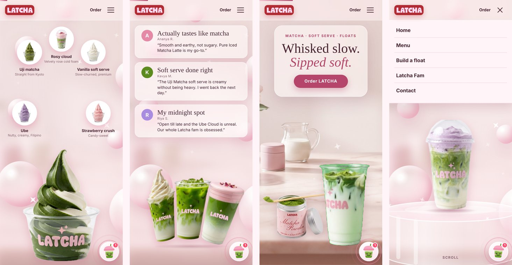

<div align="center">


# LATCHA

### Speciality matcha, cloud lattes and premium soft serve.<br>One cup. One scroll. One very pink website.

<br>


<br>


</div>

<br>

<!-- Add the live link here once the site is deployed:
<p align="center"><a href="https://YOUR-SITE.vercel.app"><b>View the live site →</b></a></p>
-->

## ✨ What it is

A single-page website for **LATCHA**, a speciality matcha and soft-serve café. One cup travels through four scenes as you scroll. After that, the page opens into the menu, a float builder and a small chat helper called **Latchi**.

It is one `index.html` file. No framework, no install, no build step.

<br>

## 🍵 What is on the page

<table>
<tr>
<td width="50%" valign="top">

### The scroll story
| Scene | What you see |
|---|---|
| **1 · Hero** | The curtain lifts, the LATCHA lettering rises letter by letter, and an Ube Cloud cup floats above a glass plinth. |
| **2 · Ingredients** | Five badges pop in around a matcha and vanilla swirl. |
| **3 · Reviews** | Three frosted-glass review cards beside three LATCHA drinks. |
| **4 · The matcha table** | An open tin, a scoop, and a cup that fills with matcha as you scroll. |

</td>
<td width="50%" valign="top">

### After the story
| Section | What it does |
|---|---|
| **Pour video** | A full-width pour clip with a turning badge. |
| **Latcha Fam** | An Instagram-style profile card and photo grid. |
| **Menu** | 33 items in 4 boards, with calories and sweetness. |
| **Build your float** | Pick a latte, a soft serve and extra matcha. |
| **Latcha 3.0** | The new cups, in a pink arch. |
| **Latchi** | A chat helper that answers menu questions. |

</td>
</tr>
</table>

**The menu**

| Board | Items |
|---|---|
| Classic Iced Matcha Lattes | 11 |
| Cloud Lattes | 6 |
| Premium Soft Serves | 8 |
| Make-your-own Matcha Floats | 8 |

Prices are left out on purpose. Every latte shows its calories and a sweetness score from 0 to 5.

<br>

## 📱 Made for phones too

<div align="center">

</div>

- **Two layouts.** The scroll story switches to a tall layout on phones and on tablets held upright, so nothing is cut off at the edges.
- **Menu button.** Below 900 px wide, the links move into a menu button. It closes when you tap a link or press `Esc`.
- **Nothing hides under the top bar.** The story keeps its text and badges clear of the fixed navigation bar.
- **Calmer motion.** If a device asks for reduced motion, the animations tone down.

<br>

## 🚀 Run it on your computer

You need Python, which is already on most computers. Open a terminal **inside this folder** and run:

```bash
# Windows
python -m http.server 8000

# Mac or Linux
python3 -m http.server 8000
```

Then open **http://localhost:8000** in your browser.

> **Tip:** type `localhost:8000` yourself. If your editor opens `http://[::]:8000`, it will show an error. That address is not a page.
>
> Always run it through a server. Some browsers block the videos when you double-click `index.html`.

Another way: in VS Code, install the **Live Server** extension, right-click `index.html` and choose **Open with Live Server**.

The page loads its fonts from Google Fonts, so it needs an internet connection to look its best.

<br>

## 🌐 Put it online

It is a static site, so any static host works. On **Vercel**:

1. Push this folder to a GitHub repository.
2. On [vercel.com](https://vercel.com), choose **Add New → Project** and import the repository.
3. Set **Framework Preset** to **Other**. Leave the build and output settings empty.
4. Click **Deploy**. Every push to `main` deploys again on its own.

Netlify, Cloudflare Pages and GitHub Pages work the same way.

<br>

## 🗂 What is in the folder

```
index.html            the whole site: HTML, CSS and JavaScript in one file
README.md             this file
assets/
├── logo.png          logo badge
├── logo-sq.png       square logo for the profile card
├── logo-word.png     transparent LATCHA lettering for the hero
├── plinth.svg        the glass plinth under the hero cup
├── cup-*.png         cut-out cups: hero, swirl, trio
├── tin-open.png      the open matcha tin
├── menu/             33 menu pictures: classic, cloud, soft, float
├── gen-*.jpg         generated scene pictures
├── photo-*.jpg       photos from LATCHA's Instagram and café
├── pour.mp4          pour video for the section after the story
├── pourcup-opaque.mp4   cup-filling clip used in the last scene
└── pourcup-static.png   still picture used if that clip cannot play
docs/                 screenshots used in this README
tools/cutout.swift    background remover for new photos (macOS only)
```

<br>

## ⚙️ How it works

- **One animation loop.** A single `requestAnimationFrame` loop runs the whole story. Your scroll position becomes a timeline, and each scene is a window of time on it.
- **A stage that fits every screen.** The scene lives in a box that measures itself, and everything inside uses height and width units. The cups land in the same place at any size.
- **Safe areas.** The script measures the navigation bar and the screen edges, then keeps badges and cards inside the visible part.
- **See-through video on every browser.** The pouring clip has a flat green backdrop. The page draws each frame on a canvas and removes the green on the fly, because some phones ignore transparent video. If autoplay is blocked, a **Tap to play** button appears.
- **Latchi** is a set of keyword rules, not an AI model. It matches whole words, so "tube" does not trigger "ube". It never quotes prices.

<br>

## 🎨 Make it yours

**Change the menu.** Edit the four lists near the top of the script in `index.html`:

| List | Each entry |
|---|---|
| `CLASSIC` and `CLOUD` | `[name, description, calories, sweetness, bestSeller?]` |
| `SOFT` and `FLOAT` | `[name, description]` |

The matching picture is `assets/menu/<group>-<number>.png`.

**Teach Latchi something new.** Add a line in the `ask()` function. Put specific questions above general ones.

**Link the Order buttons.** The **Order** button and the footer's **Zomato & Swiggy** chip open Latchi's delivery answer. To send people to your Zomato or Swiggy page instead, find `askOrder` in the script and replace it with a link.

**Swap a picture.** Replace a file in `assets/` with one of the same name. The page picks it up.

| File | Used for |
|---|---|
| `cup-ube.png` | Hero cup (transparent PNG, about 600 × 1100) |
| `cup-matchaswirl.png` | Ingredients scene |
| `cups-trio.png` | Reviews scene |
| `tin-open.png` | Matcha table scene |
| `pourcup-opaque.mp4` | Cup being filled (keep a flat green backdrop, about `#41bd46`) |
| `gen-setup.jpg` | Blurred backdrop and the table scene (16:9) |
| `menu/*.png` | Menu pictures |
| `logo.png`, `logo-sq.png`, `logo-word.png` | Logo |

**Make new cut-outs (macOS 14 or newer):**

```bash
swift tools/cutout.swift cup-photo.png 1 1 1 assets/cup-new 1100
swift tools/cutout.swift menu-sheet.png 4 3 11 assets/menu/classic 420
```

<br>

## ✅ How it was tested

Checked in Chromium (the engine behind Chrome and Edge) at widths from 320 px to 1920 px, on phone, tablet and desktop sizes.

| Check | Result |
|---|---|
| Console errors and missing files | None |
| Sideways scrolling | None at any size |
| Text, cards and badges hidden under the top bar | None |
| Keyboard: closed chat window and menu cannot be tabbed into | Pass |
| Chat answers: calories, sweetness, hours, delivery, oat milk | Pass |
| Float builder: every soft serve shows the right picture | Pass |
| Safari, iPhone and Android | **Not tested yet** |

<br>

## 📝 Before launch

These items need LATCHA's answer or a decision.

- [ ] **Order links.** Add the real Zomato and Swiggy links.
- [ ] **Reviews.** The three review cards are sample text. Replace them with LATCHA's own customer reviews.
- [ ] **Instagram numbers.** The post and follower counts are typed into the page. Update them to the live numbers.
- [ ] **Opening hours.** Latchi says "Bengaluru till 1 AM, Hyderabad till 12 AM". Confirm this.
- [ ] **Menu spelling.** "Caramel Toffe" is probably "Caramel Toffee". Check it against the printed menu.
- [ ] **Photos.** Most pictures in `assets/` are AI-generated stand-ins. Replace them with LATCHA's own photography.
- [ ] **Page weight.** The first load is about 12 MB, mostly PNG pictures. Converting them to WebP would make the site much lighter on mobile data.
- [ ] **Float picture.** The float builder changes its picture only when you change the soft serve, not the latte or the extra matcha.

<br>

## 🕒 Changelog

**v1.1**
- Added the missing `plinth.svg`. The hero no longer asks for a file that does not exist.
- Fixed the scroll story on tablets and tall windows. Cards and badges are no longer cut off.
- Keeps text and badges clear of the top navigation bar.
- Latchi now understands calorie and sweetness questions for each drink, "not sweet" in all its forms, and whole words only. The **Opening hours** button stays visible.
- The closed chat window can no longer be reached with the `Tab` key.
- New menu button for phones and tablets. The dead cart link became an **Order** button.
- Tidied the Instagram highlights, the favourites grid, the tin position on phones and the **Scroll** hint.

**v1.0**
- First version: scroll story, menu, float builder and Latchi.

<br>

## ⚖️ Content and rights

- The **LATCHA** name, logo, menu and copy belong to LATCHA. Please do not reuse them without the owner's permission.
- Pictures in `photo-*.jpg`, the logo, the three-cup picture and the swirl-cup picture are LATCHA's own images or photos taken at LATCHA. They are here for this website only.
- Most other pictures in `assets/` are AI-generated stand-ins.
- No open-source licence is attached to this code. Please ask before you reuse it.
- Fonts: Bagel Fat One, Gloock, Nunito Sans and Pinyon Script, from Google Fonts under open licences.

<br>

<div align="center">

**Built by [Sai Sathvik Goud](https://github.com/sathvik1518)**<br>
for **LATCHA** · founder **Rajasree Yarlagadda**

<sub>Whisked slow. Sipped soft. 🍵</sub>

</div>
