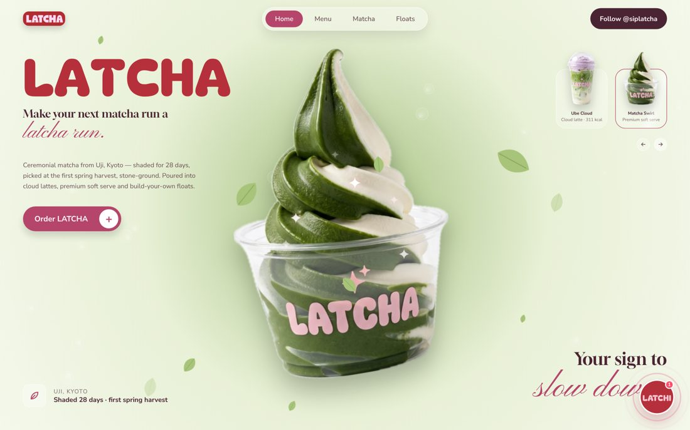
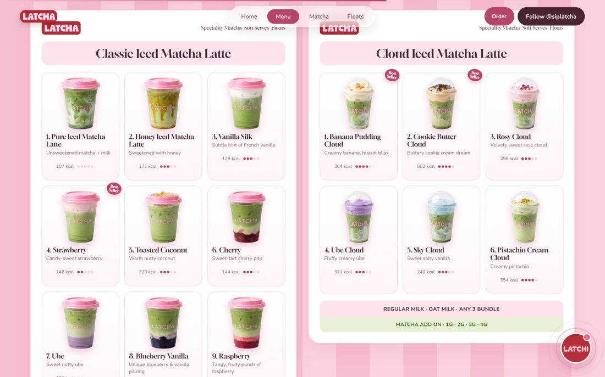
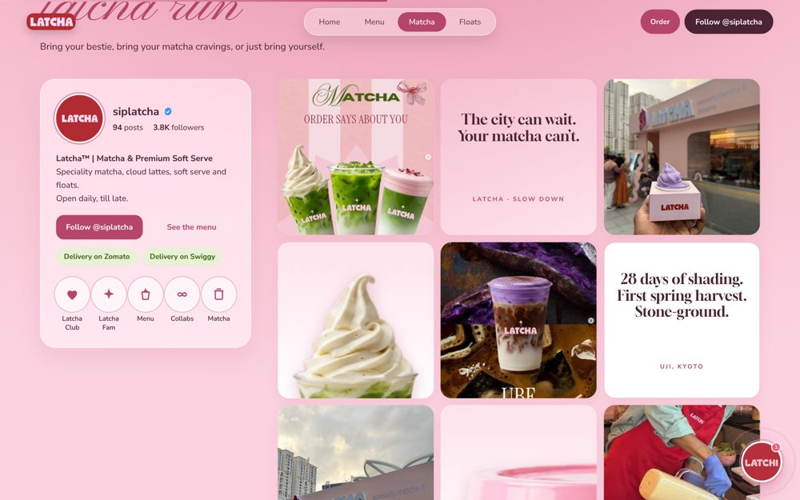
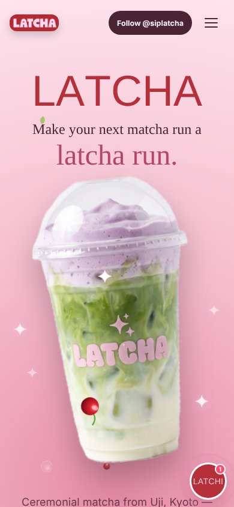
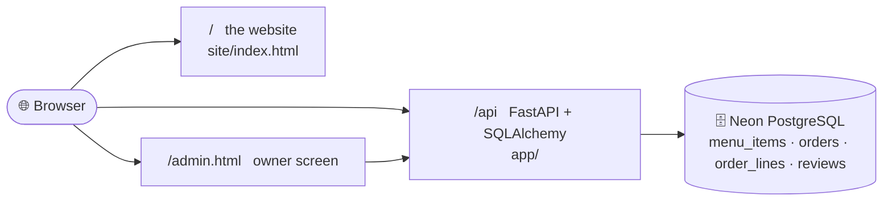

<div align="center">


# LATCHA

### A matcha café website that moves, swirls and actually takes orders.<br>One scroll to fall in love. One form to order. One link for everything.

*Whisked slow. Sipped soft.* 🍵

<br>


<br>


</div>

<br>

<p align="center">
<a href="https://latcha-website.vercel.app"><b>🍵 View the live site</b></a> &nbsp;·&nbsp;
<a href="#-try-it-on-your-computer"><b>🚀 Run it</b></a> &nbsp;·&nbsp;
<a href="#-what-every-button-does"><b>🖱 What every button does</b></a> &nbsp;·&nbsp;
<a href="#-the-api"><b>🔌 API</b></a>
</p>

<p align="center"><sub>Built for the LATCHA matcha café · Hyderabad &amp; Bengaluru</sub></p>

## 🌸 Why it feels special

| | |
|---|---|
| 🥤 **A cup you can play with** | The hero cup floats, leans and tilts with your mouse (or your phone). Cherries and leaves drift around it and move away from your pointer. |
| 💗 **One flavour tap changes the mood** | Switch from Ube Cloud to Matcha Swirl: the cup spins, the cherries fly in and out, and the whole background melts from rose pink to matcha green. |
| 🎬 **A scroll that tells a story** | Cups, the matcha tin on a marble counter, then the pour. Smooth scroll, no jumps. |
| 🛒 **A real shop behind the pretty page** | Menu of 33 dishes, order requests, an order tracker, reviews and an owner screen. All backed by a database. |
| 📱 **Made for phones first** | Same site, laid out for thumbs. Tested on a 390 px screen with no sideways scrolling. |
| 🛡 **Safe by default** | Hashed passwords, a spam trap, order limits, private tracking, reviews held until approved. |
| ✅ **Tested** | 37 automatic tests (26 API + 11 real-browser) run on every push. |

<br>

## 🍃 A day with LATCHA

| Time | Customer | Owner |
|---|---|---|
| ☀️ Morning | Scrolls the story, builds a float: a Pure Iced Matcha Latte crowned with a Vanilla Silk swirl and extra matcha | Opens `/admin.html` and sees the overnight orders |
| 🌤 Afternoon | Taps **Send order request** and gets an order number | Calls to confirm and sets the status to **Confirmed** |
| 🌙 Evening | Types the number and phone in **Track your order** and sees **Delivered** | Switches a sold-out dish off and approves a new review |

<br>

## 📸 A quick look

<p align="center">


</p>
<p align="center">


</p>
<p align="center">

</p>
<p align="center">

</p>
<p align="center"><sub>Preview pictures show the page before the 3D cherries load. On the live site they are real 3D cherries.</sub></p>

<br>

## ⚡ Run it in 60 seconds

```powershell
python -m venv .venv
.venv\Scripts\activate
pip install -r requirements-dev.txt
python scripts/init_db.py
python -m uvicorn app.main:app --port 8000 --reload
```
Open **http://localhost:8000**. No database account needed: it uses a small local file. Full steps, Neon and Vercel setup are further down.

<br>

## ✨ What it is

The LATCHA website and its backend in **one project**. One deploy gives one link: the site is at `/`, the API is at `/api`, the owner screen is at `/admin.html`.

| For customers | For the owner |
|---|---|
| A home screen with a tilting cup, floating 3D cherries and two flavour cards, then a scroll story, the full menu, a float builder and the LATCHI chat helper | Edit what is on the menu |
| **+ Add** and **−** on every dish, a cart bar, and an **Order request** form (name, phone, address) | See every order and set its status |
| **Track your order**: type the order number and phone, see Received, Confirmed or Delivered | Customers see the status you set |
| **Reviews**: read approved ones, write your own | Approve or delete reviews before the public sees them |

**The site never breaks if the backend is down.** It starts with the built-in menu, then swaps in the database menu when the API answers.

<br>

## 🎨 Design and speed

- **Home screen:** a thick crimson LATCHA wordmark, a tilted Ube Cloud cup with sparkles, floating 3D cherries and leaves, bubbles, two flavour cards and the line "Your sign to slow down." Sizes scale with the screen width, so it looks the same on a laptop and on a large monitor.
- **Colours:** the whole site uses one thick rose palette: rose `#f6bfd0`, deep rose `#e58aa6`, berry `#b5456a`, crimson `#b5303a`. The scroll story, the menu, the reviews and the footer match the home screen.
- **Chat helper:** it is called **LATCHI** everywhere.
- **Smooth scroll:** Lenis (`site/assets/vendor/lenis.min.js`).
- **3D cherries and leaves:** Google's `model-viewer` (`site/assets/vendor/model-viewer.min.js`). The 3D files load from the internet. Until they arrive, flat pictures show, so the home screen never looks empty. If the local `model-viewer` file fails, the page loads it again from a public CDN.
- **Speed:** the 3D objects start one at a time after the page loads, pictures lower down load only when you scroll near them, and the scroll story only redraws while you can see it. `speed-changes.patch` holds only these speed edits, so you can undo just them with `git apply -R speed-changes.patch` (do it before other edits to `site/index.html`).
- **Tab icon:** the LATCHA logo (`favicon.ico` and `favicon-*.png` in `site/`).
- **Pictures:** phone photos are stored upright. If you add a photo from a phone, rotate it properly before you save it as WebP, or it can show sideways.

<br>

## 🧱 How the pieces fit



<br>

## 🖱 What every button does

| Where | Control | What happens |
|---|---|---|
| Top bar | **Home, Menu, Matcha, Floats** | Scrolls to that part of the page. The menu button on a phone also lists Latcha Fam, Reviews and Contact |
| Top bar | **Follow @siplatcha** | Opens Instagram in a new tab |
| Top bar | **Order** | Appears once you scroll past the first screen. Opens the order form. Shows **Order (3)** when you have 3 items |
| Top bar (phone) | **Menu button** | Opens the links. `Esc` or tapping a link closes it |
| Hero | **Order LATCHA +** | Opens the order form |
| Hero | **Ube Cloud / Matcha Swirl cards and the two arrows** | Switch the flavour. The cup spins, the cherries fly in and out, and the background turns pink or green |
| Hero | Move the mouse over the cup | The cup tilts and the cherries move away from the pointer. On a phone it follows the tilt of the phone |
| Hero video | **Tap to play** | Starts the pouring video when the phone blocks autoplay |
| Instagram card | **Follow @siplatcha** | Opens Instagram in a new tab |
| Instagram card | **See the menu**, highlight circles | Scroll to the menu or the matching section |
| Instagram card | **Photo tiles** | Open @siplatcha on Instagram in a new tab |
| Menu | **+ Add** on each of the 33 dishes | Adds the dish to your order and shows a short message. Tap again for more. The button shows **Added ✓ ×2** |
| Menu | **−** beside **+ Add** | Takes one off. It is greyed out until you add that dish |
| Bottom of screen | **Review your order** | Appears once you add something. Opens the order form |
| Order form | **− / +** | Change how many of each dish |
| Order form | **Send order request** | Saves the order and shows your order number. LATCHA calls to confirm. No payment is taken |
| Order form | **Track this order** | Appears after you order. Opens the tracker with your order number and phone already filled in |
| Footer | **Track your order** | Opens the tracker. Type the order number and the mobile number you ordered with |
| Tracker | **Check status** | Shows Received, Confirmed, Delivered or Cancelled, plus your items. Shows nothing private (no name, phone or address) |
| Float builder | Latte, soft serve, extra matcha | Changes the picture and the summary |
| Float builder | **Add this float to my order** | Adds the matching float from the menu and puts your latte and extra matcha in the order notes |
| Float builder | **Ask LATCHI about it** | Sends your float to the chat helper |
| Reviews | **Send review** | Goes to the owner. It appears on the site once approved |
| Footer | **Follow @siplatcha** | Opens Instagram in a new tab |
| Footer | **Delivery & hours** | Opens LATCHI with the delivery answer and an **Open order form** button |
| Chat bubble | **LATCHI** | Answers menu questions. Say "order now" or press **Open order form** to order |

If the backend is offline, the **+ Add** buttons are hidden and **Order** opens LATCHI instead, so nothing shows an error.

<br>

## 🔌 The API

| Endpoint | Who | What |
|---|---|---|
| `GET /api/menu` | public | Menu items that are switched on |
| `POST /api/orders` | public | Order request. No prices or payment: LATCHA confirms by phone |
| `POST /api/orders/track` | public | Needs the order number **and** the phone used. Returns status and items only (no name, phone or address). A wrong number and a missing order give the same answer |
| `GET /api/reviews` | public | Approved reviews only |
| `POST /api/reviews` | public | Goes to the owner's queue, hidden until approved |
| `POST /api/admin/login` | owner | Gives a token that lasts 2 hours |
| `/api/admin/menu`, `/orders`, `/reviews` | owner | Switch dishes on or off, change order status, approve or delete reviews |
| `GET /api/health` | anyone | Checks the database answers |

Try everything in the browser at **`/docs`**.

**Safety built in**
- Passwords are stored as salted hashes, never as plain text.
- Orders are checked (Indian mobile number, 1 to 20 of each drink, Bengaluru or Hyderabad only), and the drink name is saved at order time. Maximum 5 orders per phone per hour.
- Order tracking needs the order number **and** the phone number. A wrong phone and a missing order give the same answer, and the reply holds only the status, items and time.
- Reviews stay hidden until approved. A hidden field catches simple spam bots. The waiting queue is capped.
- Review and order text is always shown as plain text, so nobody can inject code into the site or the owner screen.
- Database rules (rating 1 to 5, sweetness 0 to 5, quantity 1 to 20) are enforced in the database too.

<br>

## 🚀 Try it on your computer

You need **Python 3.11 or newer**. Open a terminal **inside this folder**:

```powershell
python -m venv .venv
.venv\Scripts\activate
pip install -r requirements-dev.txt
python scripts/init_db.py
python -m uvicorn app.main:app --port 8000 --reload
```

Open **http://localhost:8000**. This uses a small local file database (`dev.db`), so you do not need Neon yet.

To try the owner screen locally, copy `.env.example` to `.env`, then fill in `ADMIN_PASSWORD_HASH` and `JWT_SECRET` (steps in the next section) and restart.

Run the tests any time: `python -m pytest -q` (37 tests: 26 API and 11 browser). Browser tests need `playwright install chromium` once. They use a throw-away database, never your live site. GitHub also runs them on every push (`.github/workflows/tests.yml`).

<br>

## 🗄 Connect Neon (the real database)

1. On [neon.com](https://neon.com) create a project. Copy the **pooled** connection string (the host contains `-pooler`).
2. Make your owner password hash and a secret:
   ```powershell
   python scripts/make_admin_hash.py
   python -c "import secrets;print(secrets.token_urlsafe(48))"
   ```
3. Put the three values in `.env` (this file is never uploaded to GitHub):
   ```
   DATABASE_URL=postgresql://...-pooler.../neondb?sslmode=require
   ADMIN_PASSWORD_HASH=pbkdf2$...
   JWT_SECRET=the-long-random-text
   ```
4. Create the tables and load the menu in Neon: `python scripts/init_db.py` (safe to run twice).

<br>

## 🔑 Change the owner username or password

The owner login lives in two settings: `ADMIN_USERNAME` and `ADMIN_PASSWORD_HASH`. There is no change-password button.

1. Run `python scripts/make_admin_hash.py`, type the new password (12+ characters). It prints a line starting `pbkdf2$`.
2. In **Vercel, Settings, Environment Variables**, paste that line into `ADMIN_PASSWORD_HASH` (tick **Production**). Set `ADMIN_USERNAME` the same way. Do the same in your local `.env` if you use it.
3. **Redeploy**, and log in at the main address plus `/admin.html`.

The value must be one unbroken line with no quotes and no spaces. One stray character makes every login say "Wrong username or password". `JWT_SECRET` must also be set, or login always fails. Never share these values or screenshot your `.env`.

<br>

## 🌐 Put it online with Vercel (one project, one link)

1. **Push to GitHub.** In your project folder, delete the old files (keep the hidden `.git` folder), copy these new files in, then:
   ```powershell
   git add -A
   git commit -m "Add backend, order form and reviews"
   git push
   ```
2. **Vercel:** delete the old project (Settings, General, Delete Project), then **Add New, Project** and import the repo again.
3. Leave **Framework Preset** on **FastAPI** (or auto-detected). Leave Build and Output settings empty.
4. Before the first deploy open **Environment Variables** and add: `DATABASE_URL`, `ADMIN_USERNAME`, `ADMIN_PASSWORD_HASH`, `JWT_SECRET`. (`CORS_ORIGINS` is only needed if another website calls the API.)
5. Deploy. Then check, in this order:
   - `/api/health` shows `{"ok": true}`
   - `/` shows the site and the menu loads
   - `/admin.html` lets you log in

Neon's free plan puts the database to sleep after 5 minutes idle, so the first request after a quiet spell is slower. The menu is cached for a minute so most visitors never feel it.

<br>

## 🗂 What is in the folder

```
site/                   the website, served at /
├── index.html          the whole site (HTML, CSS, JavaScript)
├── admin.html          owner screen: orders, reviews, menu on/off
├── favicon.ico, favicon-*.png, apple-touch-icon.png   the tab icon
└── assets/             pictures and videos, plus vendor/ (lenis and model-viewer)
app/                    the backend
├── main.py             starts the app, serves the site, security headers
├── routes.py           all API endpoints
├── models.py           database tables
├── schemas.py          what each request must look like
├── security.py         password hashing and login tokens
├── db.py, config.py    database connection and settings
scripts/
├── init_db.py          create tables, load the 33 menu items
└── make_admin_hash.py  make the owner password hash
tests/                  37 automated tests
├── test_api.py         26 API tests
└── e2e/                11 browser tests (Playwright) on a throw-away database
.github/workflows/      runs the tests on every push
index.py                the file Vercel looks for (loads app/main.py)
requirements.txt        Python packages
.env.example            the settings you need (copy to .env)
docs/, tools/           README pictures, and a macOS cut-out helper
speed-changes.patch     the speed edits only, so they can be undone on their own
```

<br>

## ✅ How it was tested

| Check | Result |
|---|---|
| 26 automated API tests (orders, order tracking, reviews, login, limits, cache, site serving) | Pass on SQLite and on PostgreSQL 16 |
| 11 browser tests with Playwright (menu, + and − buttons, order, order tracking, review approval, owner login, spam trap), run on every push | Pass |
| Browser run with Chromium: menu from the database, hidden dish removed, order, bad phone message, review, owner approval, scripts in reviews do not run | Pass |
| Site with the backend switched off (built-in menu, calm messages, Order opens LATCHI) | Pass |
| Sideways scrolling on a 390 px phone | None |
| Live Vercel deploy and the Neon connection | **Pass.** `/api/health` returns `{"ok":true}` on the live site, and `/admin.html` loads |
| Owner login and order tracking on the live site | **Pass.** Checked by hand |
| Safari, iPhone and Android | **Pass.** Tried on real devices by the site owner (before the new home screen) |
| New home screen, rose colours, tab icon and speed changes | All 37 tests pass on Sathvik's PC. The look was checked in screenshots and on the live site by eye. The 3D cherries need the internet and were not tested in the build sandbox |

<br>

## 📝 Before launch

- [ ] **Who gets the orders.** Orders only appear in `/admin.html`. There is no email, SMS or WhatsApp alert yet, so someone must check it.
- [ ] **Story reviews.** The three review cards in the scroll story are sample text until three real reviews are approved.
- [ ] **Instagram numbers.** The post and follower counts are typed into the page.
- [ ] **Opening hours.** LATCHI says "Bengaluru till 1 AM, Hyderabad till 12 AM". Confirm this.
- [ ] **Menu spelling.** "Caramel Toffe" is probably "Caramel Toffee".
- [ ] **Photos.** Most pictures are AI-generated stand-ins. Replace them with LATCHA's own.
- [ ] **Page weight.** Pictures use WebP and load as you scroll, but the pour video is about 4 MB and the 3D cherries come from another server. Test on mobile data.
- [ ] **Look on every screen.** The tests check behaviour, not looks. Check colours, sizes and picture direction by eye on a laptop and a phone after each change.
- [ ] **New dishes need a picture.** Add `site/assets/menu/<category>-<number>.png`, where the number matches the dish's `position`. Without one, the card shows without a picture.

<br>

## ⚖️ Content and rights

- The **LATCHA** name, logo, menu and copy belong to LATCHA. Please do not reuse them without the owner's permission.
- Most other pictures are AI-generated stand-ins. No open-source licence is attached to this code, so please ask before you reuse it.
- Fonts: Bagel Fat One, Gloock, Nunito Sans and Pinyon Script, from Google Fonts.

<br>

<div align="center">

Made with matcha and stubbornness for **LATCHA** · founder **Rajasree Yarlagadda**

<sub>Whisked slow. Sipped soft. 🍵</sub>

<br>

## Outlets (new)

LATCHA has more than one shop, so the site does too. Customers pick an outlet in the order window and see if it is open right now. The owner can pause an outlet, change its hours, or mark a dish **sold out at one outlet only**, all from `/admin.html` → **Outlets**.

- `GET /api/outlets` lists outlets with a ready "Open now · until 1:00 AM" sentence.
- Orders can carry an `outlet`; closed, paused, "opening soon" and sold-out cases get a clear message.
- Old orders and the old city-only order form keep working. Existing databases upgrade themselves on start (`app/outlets.py`).

## UPI payments (new)

Customers can pay by UPI in the order window, or choose pay at delivery as before. The total is always worked out on the server from the menu prices, never from the browser.

| `PAYMENTS_MODE` | What happens |
|---|---|
| `demo` (default) | A pretend pay screen. No money moves. Good for showing the owner. |
| `razorpay` | Real Razorpay Checkout, UPI only. Test keys (`rzp_test_...`) use fake money. |
| `off` | No UPI choice. The site works exactly like before. |

If `razorpay` is set but the keys are missing, the mode becomes `off` (it never falls back to the pretend screen).

**Razorpay test setup:** make a free Razorpay account and stay in Test Mode. Put `PAYMENTS_MODE=razorpay`, `RAZORPAY_KEY_ID`, `RAZORPAY_KEY_SECRET` and `RAZORPAY_WEBHOOK_SECRET` in `.env` (and in Vercel > Settings > Environment Variables). In the Razorpay dashboard add a webhook to `https://YOUR-SITE/api/payments/razorpay/webhook` with the same secret, events `payment.captured`, `order.paid`, `payment.failed`.

Prices live in Admin > Menu (the first upgrade fills placeholder prices of 249 / 279 / 199 / 299 rupees: change them to the real ones). A UPI order is only offered when every dish in it has a price.

Safe by design: the server checks Razorpay's signature, a repeated payment message changes nothing, a webhook with the wrong amount is ignored, and the pretend pay button stops working as soon as real payments are on.

## Live order screen and menu editor (new)

Admin > Orders now updates by itself every 12 seconds (and the moment you return to the tab). When a new order arrives you see a banner, the new card flashes, and the tab title shows `(2) LATCHA Owner`. Press **Sound off** once to turn on a soft beep (browsers only allow sound after a click).

- Tiles: new, being made, waiting for payment, today's orders, rupees paid today (Indian time, cancelled orders not counted).
- Filters: Active (new and confirmed), Delivered, Cancelled, All, plus an outlet filter.
- One-tap buttons: Confirm order, Mark delivered, Cancel order (asks first). The phone number is a tap-to-call link.
- Admin > Menu: search box, and **Edit details** on each dish (name, description, calories, sweetness) next to the price, on-the-menu and best-seller switches. Order history keeps the old dish name.
- The menu boards on the home page use fixed pictures and a fixed layout, so this editor changes existing dishes only. It does not add or delete dishes.

## Latcha Fam loyalty (new)

Every drink that LATCHA marks **Delivered** is 1 sip on the customer's mobile number. 8 sips = 1 free drink (change the number with `FAM_SIPS_PER_REWARD` in `.env`).

- Customers see their card from the footer button **Latcha Fam**, and a small strip with pearls inside the order window once the mobile number is typed.
- "Use my free drink" takes off the cheapest drink in the cart. If that makes the total ₹0, no payment is asked and the order is marked paid.
- A cancelled order gives the free drink back. Nothing extra is stored: sips are counted from the orders table.
- Owner: Admin → **Fam** lists every member (sips, orders, free drinks ready or used). Order cards show "Fam free drink −₹…".
- Limit: there is no OTP, so anyone who knows a mobile number can see its sips or reserve its free drink. The owner's confirmation call is the safeguard.
- Free drinks need prices. The prices are placeholders until you set the real ones in Admin → Menu.

## Find my matcha quiz (new)

A 4-tap quiz (format, flavour, sweetness, light or treat) that picks one dish and two more ideas from the live menu. A button sits under the menu heading and another in the footer.

- It is plain rules, not AI. A dish scores points for the chosen format, the flavour mood (found from the dish name and description), how close its sweetness is, and its calories. Best sellers get a small tie-break bonus.
- It reads the menu from the database, so new or edited dishes are used automatically. For a new dish to match a flavour mood, put words like strawberry, caramel, ube, vanilla or matcha in its name or description.
- Dishes marked sold out at the customer's chosen outlet are skipped.
- Soft serves and floats have no sweetness or calorie numbers yet, so those two questions do not change their score.
- "Add" puts the dish in the cart; "Open my order" goes straight to the order window.
- Nothing is stored and there is no new database table or API.

**By Sathvik & Sunny**

</div>
